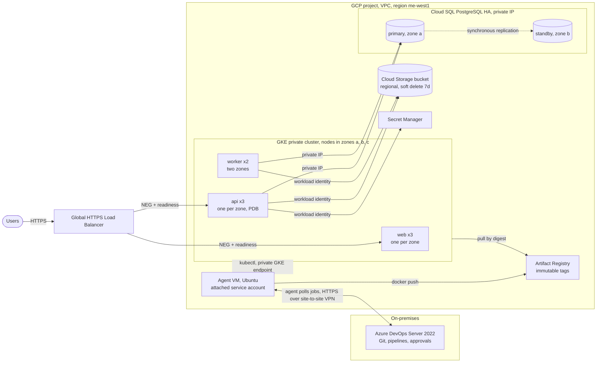

# Solution: survey service reliability and delivery

Scope: concrete changes a small DevOps team can implement on the existing GCP setup.
The VPN, HTTPS entry point, identity (attached SA, Workload Identity, no key files) and
Secret Manager stay as they are. Names, project IDs and data are synthetic.

## Corrected architecture

Source: [diagrams/architecture.mmd](diagrams/architecture.mmd). Release and rollback flow:
[diagrams/release-recovery.mmd](diagrams/release-recovery.mmd).

## Assumptions

| # | Assumption |
| --- | --- |
| A1 | The GKE cluster is zonal (one control-plane zone) with one node pool. |
| A2 | The HTTPS load balancer is a GKE Ingress with container-native load balancing (NEGs). |
| A3 | The API is stateless; all state is in Cloud SQL and Cloud Storage. |
| A4 | Database migrations are versioned (e.g. Alembic). |
| A5 | Worker jobs are idempotent and can be retried. |
| A6 | Times in the incident are Israel time (UTC+2 in winter); gcloud uses UTC. |
| A7 | The database is tens of GB, so a PITR clone finishes in well under an hour (to be measured in a drill). |

---

## 1. Service interruptions (releases and node maintenance)

**Cause / risk**
- One API replica: every rollout or node drain leaves zero pods for a moment, so users get 502/503.
- No readiness probe: new pods receive traffic before the app is ready.
- No startup probe: adding a liveness probe alone would kill slow-starting pods.
- No resource requests/limits: the scheduler cannot place pods safely; one pod can exhaust a node.
- No graceful shutdown: in-flight requests are cut at SIGTERM, and the load balancer still
  sends traffic to a terminating pod.
- Both nodes in one zone: maintenance removes half the capacity; a zone outage removes everything.

**Fix** ([k8s/api-deployment.yaml](k8s/api-deployment.yaml), [k8s/health.py](k8s/health.py))

| Setting | Purpose |
| --- | --- |
| `replicas: 3` + `topologySpreadConstraints` (zone, hostname; `ScheduleAnyway`) | One pod per zone; survives a pod, node or zone loss. `ScheduleAnyway` still allows rescheduling into surviving zones. |
| `RollingUpdate maxSurge: 1, maxUnavailable: 0` | A new pod must be Ready before an old one is removed; capacity never drops during a release. |
| `startupProbe` (up to 120 s) | Liveness and readiness wait until the app has started. |
| `readinessProbe /healthz/ready` | Traffic only to pods that can serve. Returns 503 during startup and shutdown. It does not check the DB, so a DB failover does not empty the load balancer. |
| `livenessProbe /healthz/live` | Restarts a hung process only; never depends on the DB, which avoids cascading restarts. |
| `requests` cpu/memory, memory `limit` | Correct scheduling and protection from OOM. No CPU limit, to avoid throttling (tradeoff). |
| `preStop: sleep 15` | Gives the NEG and kube-proxy time to remove the endpoint before the app gets SIGTERM. |
| uvicorn `--timeout-graceful-shutdown 25`, `terminationGracePeriodSeconds: 45` | Finish in-flight requests; 45 > 15 + 25, so SIGKILL is not reached. |
| `PodDisruptionBudget maxUnavailable: 1` | Node drains and GKE upgrades remove at most one API pod at a time. |
| `BackendConfig` connection draining 30 s, health check on `/healthz/ready` | The load balancer drains open connections and uses the same readiness signal. |
| Image by digest (`@sha256:`) | The exact version is known (see problem 4). |

The same pattern applies to the web frontend. The worker gets at least 2 replicas, a longer
grace period (e.g. 300 s) and stops taking new jobs on SIGTERM.

Node maintenance: surge upgrades on the node pool (`--max-surge-upgrade=1
--max-unavailable-upgrade=0`) and a weekly maintenance window. GKE respects PDBs during upgrades.

**Safe implementation**
1. Ship the health endpoints in the app.
2. Add requests/limits sized from one week of `kubectl top` and Cloud Monitoring data.
3. Add startup and readiness probes, then liveness.
4. Add replicas, the PDB, preStop and the BackendConfig.
5. Spread the node pool across zones (section 1b), then the spread constraints take effect.

**Verification**
- Local kind cluster with 3 workers labeled as fake zones ([k8s/kind-3zones.yaml](k8s/kind-3zones.yaml)).
- [k8s/test-availability.sh](k8s/test-availability.sh) generates load from inside the cluster
  through the Service during a `rollout restart` and a `kubectl drain`. Expected result: `fail=0`.
- `kubectl get pods -o wide`: one pod per zone. `kubectl get pdb -w` during the drain: at most one pod missing.
- A slow-start test (sleep 60 at startup): the pod is not killed and becomes Ready later.
- In GKE (proposed): the same load test through the load balancer during a node pool upgrade.

## 1b. Zone outage (separate from the deployment fix)

**What happens today:** both nodes and the single-zone Cloud SQL instance are in the failed
zone, so the whole service is down until the zone returns. The regional bucket, global load
balancer, Artifact Registry and Secret Manager keep working. The agent VM is also zonal: CI
stops, but the service is not affected.

**Minimum changes**

| Change | Command (proposed) | Tradeoff |
| --- | --- | --- |
| Nodes in 3 zones | `gcloud container clusters update survey-gke --zone=me-west1-a --node-locations=me-west1-a,me-west1-b,me-west1-c` | Nodes survive, but a zonal control plane cannot deploy or scale during the outage. Better: a new regional cluster and migrate (a zonal cluster cannot be converted in place). |
| N+1 capacity | 3 nodes, one per zone, sized so 2 nodes carry the full load | Cost of one more node. |
| Cloud SQL HA | `gcloud sql instances patch survey-db --availability-type=REGIONAL` | About double the DB cost. Brief restart, so do it in a maintenance window. Automatic failover in about a minute, with the same private IP. |
| App survives failover | Connection pool with pre-ping and retry with backoff | A few seconds of errors during failover. |

A full region outage is out of scope; it would need a cross-region replica and a DR plan.

---

## 2. Backup and recovery

**Limits of the current setup**
- Daily backup without PITR: the newest restore point is the last daily backup. If it ran at
  03:00, about 7 h 20 min of changes are lost. The RPO target of 15 min is not met.
- Restoring a backup onto the same instance overwrites all data written after the backup.
- No versioning or soft delete: the deleted objects are gone permanently, and DB rows point to missing files.
- Recovery was never tested, so the RTO is unknown.
- Backups belong to the instance; deleting the instance is a risk without deletion protection.

**Changes before an incident** ([recovery/before-incident.sh](recovery/before-incident.sh))

| Target | Mechanism |
| --- | --- |
| RPO <= 15 min | PITR with 7 days of transaction logs (restore to any second in the window). |
| RTO <= 2 h | Clone to a new instance, a written runbook and a measured restore drill. |
| Files recoverable for 7 days | Bucket soft delete set to 7 days (optionally versioning with a 7-day noncurrent lifecycle rule). |
| Investigation | Data Access audit logs for Cloud SQL and Cloud Storage. |
| Prevention | 14 retained backups, deletion protection, operators read-only on prod data. |

**Recovery: surgical restore (recommended)**

Restoring the whole database to 10:19 and switching the app to it would also discard
legitimate writes made between 10:20 and the freeze, which breaks the 15-minute RPO. Instead,
the clone is used as a source, and only the deleted rows are copied back into prod. A full
switch to the clone is the fallback if prod itself is badly damaged.

1. **10:35 Declare the incident.** Name an incident lead and open a channel.
2. **Stop further damage.** Revoke the operator's access to the script or role that deleted data.
   Scale the worker to 0 so it does not process rows whose files are missing. The API stays up,
   or goes read-only if the app supports it.
3. **Restore destination.** PITR clone to a **new** instance one minute before the mistake (never
   over prod): `gcloud sql instances clone survey-db survey-db-rec-0819 --point-in-time='2026-11-11T08:19:00Z'`.
   The exact time comes from the audit logs. 10:19 Israel time is 08:19 UTC.
4. **Files.** List soft-deleted objects and restore those deleted in the incident window
   ([recovery/restore-steps.sh](recovery/restore-steps.sh)). Objects return to the same paths,
   so existing DB references work again.
5. **Copy rows back.** Connect to the clone and to prod through the Cloud SQL Auth Proxy with IAM.
   Find the missing rows ([recovery/verify.sql](recovery/verify.sql), query 1). Copy them in
   foreign-key order inside one transaction with `ON CONFLICT DO NOTHING`, then fix sequences if needed.
6. **Database/file consistency.** Query 2: every row points to an existing object (expected 0).
   Also list restored objects without a row, and decide what to do with them.
7. **Application reconnection.** Prod is unchanged, so `kubectl rollout restart` the API and
   worker to reset pools and caches. (For a full switch: update the instance connection name or
   IP in Secret Manager or a ConfigMap, then restart.)
8. **Checks before reopening.** Row counts and the restored IDs are present. Sample files download
   and match their checksums. An end-to-end smoke test passes: upload, validate, report. The error
   rate is normal. Then scale the worker back up.
9. **Close.** Inform users, keep the clone for 48 h as evidence, then delete it. Write a postmortem.

Expected timeline: detect 10:35, clone and file restore started 10:45, clone ready about 11:30,
rows copied and checked about 11:50, service fully open about 12:10. That is about 95 minutes,
within the 2-hour RTO, assuming the clone time from A7.

**Proving the targets**
- A quarterly restore drill on synthetic data: delete rows and objects in a non-production clone,
  run this runbook end to end and record the times. This is the RTO evidence.
- RPO evidence: write a row with a known timestamp, restore to T, and check that the row from
  T-1 min exists.
- Files: delete a test object, restore it 6 days later and compare the checksum.
- A weekly automated check that PITR is enabled and soft delete is 7 days, plus an alert on
  backup failure.

---

## 3. Linux pipeline agent: `No space left on device`

**Cause / risk**
- 76G + 4G + 12G = 92G is measured. About 7G is still unexplained: /var/log, /tmp, /home, or
  deleted files that are still open.
- `Avail 0` with 99G of 100G used: ext4 reserves about 5% for root, so normal users already
  get ENOSPC.
- The likely cause: every `latest` build leaves the previous image dangling, the BuildKit cache
  grows without limit, and old `_work` folders are never removed.

**Investigation (read-only)**: [scripts/agent-diagnose.sh](scripts/agent-diagnose.sh): `df -h`,
`df -i`, `du -xhd1 /`, `docker system df -v`, `docker ps -a`, dangling images, `docker buildx du`,
`du` on `_work`, `journalctl --disk-usage`, `lsof +L1`, and whether `Agent.Worker` is running.

**Check before deleting anything**
- No job is running (`pgrep -af Agent.Worker`, plus the agent's Jobs tab), and the agent is
  disabled in the pool so no new job starts.
- Other agent services on the same disk.
- No running container that someone started by hand (`docker ps`).
- Volumes reviewed (`docker volume ls`) before any volume deletion.
- No unpublished artifacts in `_work`. Everything else is rebuildable from Git and the registry.
- Docker's data root (`docker info`).

**Safe immediate recovery**: [scripts/agent-cleanup.sh](scripts/agent-cleanup.sh)
1. Disable the agent in the pool, confirm no job and no `docker build` is running, and stop
   the agent service.
2. `journalctl --vacuum-size=200M` for a quick small win.
3. `docker container prune`, then `docker builder prune --filter until=24h`, then
   `docker image prune -a --filter until=72h`.
4. Remove `_work` build folders older than 2 days, and `_work/_temp`.
5. If the disk is still at 80% or more, run `docker builder prune -a`. The age filters keep
   fresh cache, so in an emergency they can free almost nothing (tested in the lab: 0B). It is
   safe because nothing is building; the next build is only slower.
6. Check `df -h`, start the agent, enable it in the pool and run a test build.

Never `rm -rf /var/lib/docker` while Docker runs, and never `docker system prune --volumes`
without a review.

**Prevention**
- Docker settings ([scripts/docker-daemon.json](scripts/docker-daemon.json)): log rotation and
  builder garbage collection (keep 20GB).
- A nightly systemd timer ([scripts/agent-cleanup.timer](scripts/agent-cleanup.timer)) that prunes
  by age.
- Pipelines use `clean: true` and remove their local image after the push (problem 4 YAML).
- Ops Agent with a Cloud Monitoring alert at 80% disk.
- Optional: a separate disk for /var/lib/docker, or ephemeral agents built from an image.

**Verification:** on a local Docker host, build several images and compare `docker system df`
before and after the cleanup (see the status table in the README). Tested in a local lab (a
Docker-in-Docker agent with its own 4G disk, scripts/local-test/agent-lab.yaml): without builder GC
the 11th build failed with `no space left on device`; the fixed cleanup script took the disk from
100% to 19% and a test build passed; with builder GC (limit scaled to 800MB) 15 builds passed and
the disk peaked at 93%. GC frees space after builds, it is not a hard cap, so the 80% alert and
the nightly cleanup are still needed. The scripts pass `bash -n`. On the agent: disk use
below 60%, a test build passes, and the timer appears in `systemctl list-timers`.

---

## 4. Failed release

**Cause / risk:** `latest` is a moving label, so there is no rollback target. The migration
runs without a DB safety point, and there are no PR checks or production approval.

**Pipeline flow** ([pipelines/azure-pipelines.yml](pipelines/azure-pipelines.yml)):
PR build validation, then merge to `main`, then build, test and push the image tagged with the
commit SHA, then record the digest, then approval on the `survey-production` environment, then
an on-demand backup and recording of the time, then the migration Job, then deploy by digest,
`rollout status` and a smoke test. Environment-specific steps are marked as **pseudocode**.

Key points:
- Tag = `$(Build.SourceVersion)`. The digest comes from `docker inspect RepoDigests`, is passed
  as an output variable to the deploy stage, and is published as a run artifact.
- Deployed version recorded in three places: the run artifact `image-ref.txt`, the
  `kubernetes.io/change-cause` annotation, and the `prod-deployed` run tag. The previous image is
  saved before the deploy.
- `pr: none` in YAML, because in Azure Repos PR validation is configured by the Build validation
  branch policy.
- Environment `survey-production`: Approvals (requester cannot approve their own run), Branch
  control (`refs/heads/main` only) and Exclusive lock. Artifact Registry immutable tags.

**Recovering from a failed release**
- **Compatible migration (expand only):** `kubectl rollout undo`, or `set image` to the recorded
  previous digest. Check rollout status and run the smoke test. The DB stays as it is.
- **Incompatible migration** (drop or rename, type change): redeploying the old image fails
  against the new schema. In order of preference: (1) fix forward through the same pipeline;
  (2) a pre-tested down-migration without data loss, then roll back the app; (3) last resort:
  a PITR clone to the recorded pre-migration time. Writes after the migration are lost unless
  copied back as in problem 2. That is a business decision.
- **Prevention, expand/contract:** release N adds, release N+1 switches reads, and release N+2
  drops, so every release is compatible with the previous app. PRs with `DROP` or `RENAME` in
  migrations require an extra reviewer, and PR validation runs migrations against a throwaway
  Postgres container.

**Tested locally** (kubeadm, see the README table): with `latest`, `kubectl rollout undo` brought
back the template but the pods pulled the new image again (v2); deployed by digest with a
`kubernetes.io/change-cause` annotation, undo returned v1 and `rollout history` showed each
release. A rebuilt "v1" got a different digest, so an unrecorded digest cannot be recovered.
After a column rename the old app failed (`column "comment" does not exist`); the down-migration
restored v1 without data loss but broke v2; with expand (new column, old one kept, sync trigger)
both versions worked, and contract is the point of no return.

---

## 5. Git controls

**Workflow:** short-lived `feature/*` and `hotfix/*` branches, then a PR to a protected `main`,
then CI, then production approval.

**Azure DevOps branch policies on `main`**
- Require a minimum number of reviewers: 1. Requestors cannot approve their own changes, and
  votes reset on new pushes.
- Build validation: this pipeline, required, expires after 12 h.
- Check for comment resolution: required.
- Limit merge types: squash merge.
- Automatically included reviewers for `/k8s/*`, `/pipelines/*` and `/migrations/*`.
- Repository security: deny "Bypass policies" and "Force push" to everyone except a documented
  break-glass group.

**Pipeline controls:** CI trigger only on `main`, a prod stage condition on `main`, and an
environment with Approvals and Branch control. Pipeline permissions on the agent pool and
service connections are limited to this pipeline.

**Urgent fix:** a `hotfix/*` branch from `main`, a small PR, the same build validation, and an
on-call reviewer and approver available immediately. It is faster because the change is small
and people are available, not because controls are skipped. Any break-glass use is audited and
reviewed in the postmortem.

**Tested locally** with a server-side git hook as a stand-in for the branch policies: a direct
push to `main`, a force push and a branch outside `feature/*`/`hotfix/*` were rejected; a commit
reached `main` only from a work branch and only when every script passed `bash -n`; the hotfix went
through the same checks. Reviewer and approval rules need Azure DevOps and were not tested.

---

## Tradeoffs and not in scope
- No staging environment (out of scope per the assignment). It would be the next step for
  release safety.
- A regional GKE cluster is recommended over multi-zonal nodes, but it needs a migration.
- Cloud SQL HA and soft delete increase cost. They are justified by the targets.
- No Terraform. Commands are shown with gcloud for clarity.
